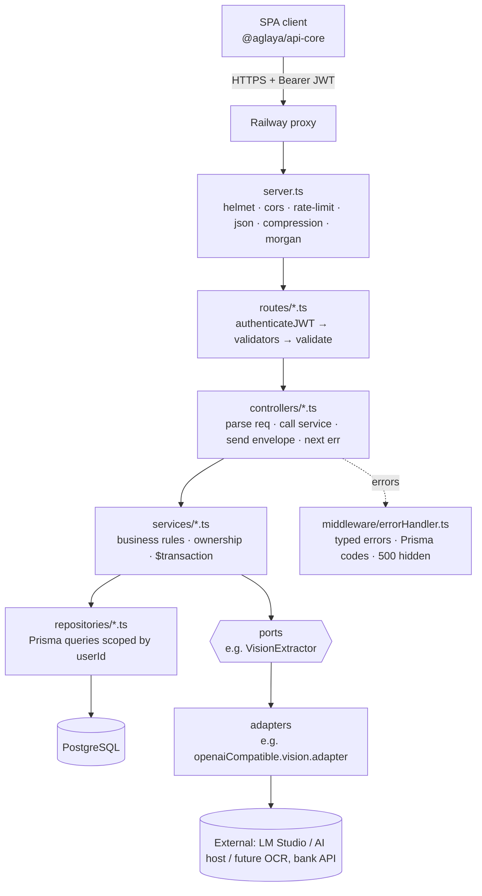

# Backend architecture & toolchain

## TL;DR

**Style:** a **modular monolith** with a **strict 4-layer architecture** inside, plus
**ports & adapters (hexagonal)** at the edges where we talk to external systems.
One deployable (Docker image on Railway), one PostgreSQL database.

**Why:** one developer, one frontend, personal-finance scale (thousands of rows per
user, not millions of requests per second). A monolith gives atomic DB transactions
for money (a balance and its transaction commit together), one deploy, one place to
debug. Microservices would buy nothing here except distributed-transaction problems
on a ledger. Revisit only if a part needs a different scaling or release cadence —
see "When to break the rules" below.

## 1. How a request flows

| Layer | Folder | Owns | Must NOT |
|---|---|---|---|
| Routes | `src/routes/` | paths, middleware order, `@openapi` docs | contain logic |
| Controllers | `src/controllers/` | HTTP in/out, envelope, `next(error)` | touch Prisma, hold business rules |
| Services | `src/services/` | business rules, orchestration, transactions | touch `req`/`res`, know status codes |
| Repositories | `src/repositories/` | Prisma queries, user scoping | throw HTTP errors, hold rules |
| Pure rules | `src/services/ledgerRules.ts`, `src/utils/money.ts` | deterministic domain functions | do I/O |
| Ports & adapters | `src/services/googleSheets/` (Google Sheets export), `src/services/ai/` (receipt branch) | interface to an external system + its implementations | leak vendor types into services |
| Cross-cutting | `src/middleware/` (`auth.ts`, `validate.ts`, `errorHandler.ts`, `rateLimiters.ts`, uploads), `src/errors/` (`AppError` + domain errors), `src/config/` (`env.ts`, `database.ts`, `logger.ts`) | auth, validation, uploads, errors, config, DB client | — |

**Dependency direction is one-way: down.** A lower layer never imports a higher one.

### Feature modules

Small resources are just one file per layer (`account.*`). A feature with several
internal parts gets a folder under `services/` (`services/xlsxImport/` → `parser.ts`,
`dedupe.ts`, `types.ts`, `xlsxImport.service.ts`). Follow that when a service grows
beyond ~300 lines or has distinct sub-steps.

### Ports & adapters for external systems

Any external dependency that could be swapped (AI vision model, OCR engine, bank
feed, email, object storage) gets:

1. A **port**: a TS interface in the service's terms (`VisionExtractor.extract(req)`),
   no vendor types.
2. One or more **adapters** implementing it (`openaiCompatible.vision.adapter.ts`),
   configured by env vars (`VISION_BASE_URL`, model, timeout).
3. **Typed errors** for the failure modes (`VisionTimeoutError`, `VisionUnavailableError`,
   `VisionOutputInvalidError`) so the service and errorHandler stay vendor-neutral.
4. Output **validated** against a schema and normalized before it touches business
   logic — external output is untrusted input.

This is why switching from an AI model to a non-AI OCR engine (e.g. tesseract.js) is
"write one adapter", not a rewrite.

## 2. The toolchain — one tool per job

| Job | Tool | Notes |
|---|---|---|
| Runtime | **Node 22 LTS** (`node:22-slim`) | `engines >=22.12.0`; Node 20 is EOL (Apr 2026). Move to 24 LTS once Prisma is upgraded |
| Language | **TypeScript 5, strict** | `noUncheckedIndexedAccess`, `exactOptionalPropertyTypes` |
| HTTP framework | **Express 4** | async errors need try/catch + `next(err)` |
| Database | **PostgreSQL** | managed (Prisma Cloud) in staging/prod; container in dev |
| ORM / migrations | **Prisma 5** | single client in `config/database.ts`; `migrate deploy` pre-deploy |
| Validation | **express-validator 7** | chains in `validators/`, `validate` middleware |
| Auth | **jsonwebtoken** + **bcryptjs** | JWT Bearer, DB-backed blacklist, single active session (`sid`) |
| Security headers | **helmet** | defaults |
| CORS | **cors** | allow-list from `CORS_ORIGIN` |
| Rate limiting | **express-rate-limit** | on `/api/`; needs `TRUST_PROXY_HOPS` behind a proxy |
| Uploads | **multer** (memory storage) | per-type middleware: `xlsxUpload`, `imageUpload` (receipt branch) |
| Excel parsing | **exceljs** | `services/xlsxImport/parser.ts` |
| Google OAuth / Sheets | **google-auth-library** + **@googleapis/sheets** (not the full `googleapis` bundle) | only imported by `services/googleSheets/adapters/google.adapter.ts` |
| Logging (app) | **@aglaya/logger** via `config/logger.ts` | never `console.*` |
| Logging (HTTP) | **morgan** | `dev` locally, `combined` elsewhere |
| Compression | **compression** | |
| API docs | **swagger-jsdoc** + **swagger-ui-express** | `@openapi` JSDoc in routes; `/api-docs`, `/api-docs.json` |
| Client types | **openapi-typescript** | `yarn generate:client` → `src/types/openapi.d.ts` |
| Tests | **Vitest 4** (+ `@vitest/coverage-v8`, **supertest** available for HTTP tests) | mocks for repos and `$transaction` |
| Lint / style | **ESLint 10** flat config (`eslint.config.mjs`) + **neostandard** (`semi: true`) + type-aware typescript-eslint rules | 2 spaces, single quotes, semicolons |
| Dev runner | **tsx** | hot reload; does NOT type-check — run `yarn type-check` |
| Package manager | **Yarn 1 (classic)** | `yarn.lock` is the source of truth; don't add npm/pnpm lockfiles |
| Container | **Docker**, single multi-stage Dockerfile | `deps → builder → pruned → production`, runs as non-root `nodejs` |
| Local orchestration | **docker compose** base + overrides | `compose:dev`, `compose:staging`, `compose:prod` |
| Hosting | **Railway** | `railway.json`: Dockerfile builder, `/health`, pre-deploy migrations |
| API manual testing | **Insomnia** collection | keep the folders in sync with new endpoints |

Commands for all of these are in CLAUDE.md.

## 3. Key decisions (and why) — don't undo without discussing

| Decision | Why |
|---|---|
| Modular monolith, not microservices | Atomic money writes; one dev; scale doesn't require it |
| Strict layering | Testable services without HTTP; one place for each concern |
| Money as integer cents (expand/contract from Float in progress) | Exact sums in JS and SQL |
| Transactions are the only thing that moves balances | Balances always reconcile with history |
| Ownership → 404 | Don't reveal other users' IDs |
| Typed errors (`AppError` base) + controllers `next(error)` + one global errorHandler | Stable `errorCode` contract; 500 internals hidden; one envelope |
| Secrets read via `config/env.ts`, no defaults, checked at boot | A misconfigured deploy fails loudly instead of running insecurely |
| Migrations as Railway pre-deploy, not on start | Avoid races across replicas |
| One Dockerfile for all envs | Envs differ by config, not by build |
| Two-phase imports (parse → confirm) + `importHash` | User reviews before writes; re-imports are idempotent |
| External systems behind ports | Swap vendors/models without touching business logic |
| Server-side sessions via `sid` + blacklist (not pure stateless JWT) | Logout and "single active session" actually work |

## 4. Adding a dependency or integration

Before `yarn add`:
1. **Can the existing stack do it?** (Prisma `groupBy` before a reporting lib; `crypto`
   before a hashing lib; `fetch` (built into Node) before axios.)
2. **Is it maintained and widely used?** Recent releases, no open critical advisories
   (`yarn audit`), compatible license (MIT/Apache/BSD/ISC).
3. **What does it cost at runtime?** Native binaries must work on `node:22-slim` for
   x86_64 and ARM64; memory on Railway is limited.
4. **Wrap it** if it's an external system or likely to change (port + adapter); a pure
   utility can be imported directly from one place.
5. Runtime deps in `dependencies`, build/test-only in `devDependencies` (the `pruned`
   Docker stage drops dev deps — a misplaced runtime dep crashes prod, not dev).
6. Mention the new dependency and why in the PR/summary.

## 5. When to break the rules (signals, not wishes)

| Signal | Then consider |
|---|---|
| A request does slow work (AI extraction, big imports) and hits proxy timeouts | A job table in Postgres + a worker process (same codebase, second Railway service) before adding Redis/BullMQ or Kafka |
| The same expensive read is hammered and measured as a bottleneck | HTTP caching (ETag pattern) first; then an in-process cache; Redis only with multiple replicas |
| A module needs independent deploys or scaling | Extract it behind its existing port — the port is the future service boundary |
| Reporting queries slow down OLTP | Postgres read replica or materialized views before a separate analytics store |

Default answer to "should we add a queue / cache / microservice?" is **not yet** —
ask what measured problem it solves.

## Related skills
- `backend-new-resource` — where each file of a new feature goes
- `backend-api-design` — HTTP contract rules
- `backend-data-practices` — schema, money, transactions, migrations
- `backend-security` — threat model and security controls
- `backend-code-review` — review checklist
